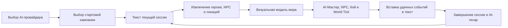
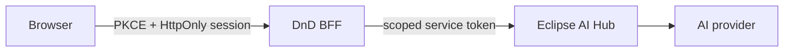
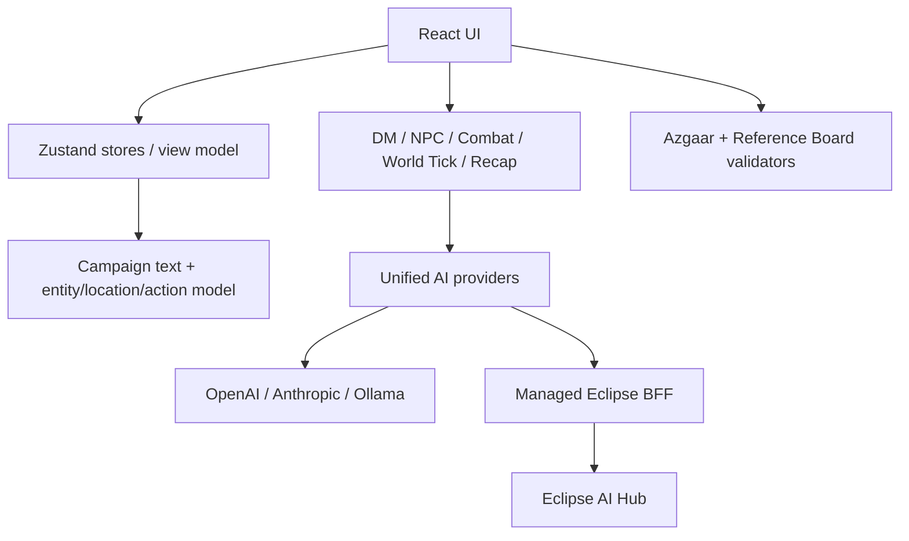

# Eclipse DnD Forge

## Полное описание продукта, функциональности, архитектуры и границ готовности

> **Состояние документа:** актуально для local checkout на 23 августа 2026 года
> **Текущая ветка продукта:** однопользовательское AI-first рабочее пространство мастера и автора кампаний
> **Текущее публичное имя в коде:** `Eclipse DnD Forge`
> **Выбранное направление будущего бренда:** `Eclivarium by Eclipse Story` / «Экливариум» — ещё не внедрено и юридически **NOT CLEARED**

---

## 1. Кратко о продукте

Eclipse DnD Forge — браузерное рабочее пространство, в котором мастер настольной ролевой игры может одновременно вести текст сессии, визуальную модель мира, персонажей, локации, события, бой и диалоги с AI-персонажами.

Главная идея продукта — двусторонняя связь между рассказом и структурой мира:

```text
Текст сессии  ⇄  герои / NPC / существа  ⇄  локации  ⇄  действия и последствия
```

Пользователь может писать историю обычным текстом, извлекать из неё сущности и связи, менять мир через визуальные графы, а затем просить AI переписать текст с учётом этих изменений. Вокруг этого ядра собраны инструменты мастера: AI-ведущий, диалоги с NPC, автономное развитие мира, генераторы, кубики, инициатива, архив сессий, карта мира и Reference Board.

Сейчас это сильный локальный прототип и рабочий инструмент для одного мастера. Это ещё не полноценный многопользовательский VTT, не облачный менеджер нескольких кампаний и не готовый к коммерческому запуску SaaS.

---

## 2. Статусы возможностей

В документе используются три уровня готовности:

| Статус | Значение |
|---|---|
| **Реализовано** | Возможность присутствует в текущем интерфейсе и коде. |
| **С ограничениями** | Основной сценарий работает, но остаются важные продуктовые, технические или legal/security-ограничения. |
| **Не реализовано** | Возможность относится к целевому продукту, но в текущем checkout отсутствует. |

---

## 3. Для кого предназначен продукт

### Основная аудитория

- мастер, который готовит и ведёт собственную кампанию;
- автор мира, которому важно видеть персонажей, места и события как связанную систему;
- соло-игрок или сценарист, использующий AI для прототипирования сцен;
- небольшая творческая команда на этапе подготовки проекта — пока без совместной работы внутри приложения.

### Основные задачи пользователя

1. Быстро начать кампанию с готовой основой или чистого листа.
2. Вести текст текущей сессии в одном месте.
3. Не терять персонажей, их цели, тайны, знания и взаимосвязи.
4. Понимать, где происходят события и как устроен мир.
5. Получать AI-помощь без необходимости вручную составлять сложные промпты.
6. Поддерживать живой мир, в котором NPC и фракции действуют за кадром.
7. Сохранять итоги завершённых глав и возвращать их в контекст следующей игры.
8. Хранить визуальные референсы с понятным происхождением и статусом прав.

---

## 4. Главный пользовательский сценарий



### Как выглядит один рабочий цикл

1. Пользователь открывает launcher.
2. Выбирает AI-провайдера и модель.
3. Запускает один из стартовых шаблонов или пустую кампанию.
4. Пишет или редактирует текст сессии.
5. Нажимает синхронизацию «текст → граф».
6. Получает героев, NPC, существ, фракции, локации и действия на визуальных холстах.
7. Использует AI-Мастера, диалоги, генераторы, World Tick, кубики и инициативу во время подготовки или игры.
8. Вставляет выбранные AI-результаты в канонический текст сессии.
9. Завершает главу, получает краткий recap и начинает следующую сессию с сохранённым контекстом.

---

## 5. Функциональная карта

| Область | Что умеет | Статус |
|---|---|---|
| Launcher | Выбор AI, модели, fallback-цепочки и стартовой кампании | **Реализовано** |
| Текстовый редактор | Ведение канонического текста сессии | **Реализовано** |
| Текст → граф | Извлечение сущностей, локаций и действий через AI | **Реализовано** |
| Граф → текст | Переписывание истории после визуальных изменений | **Реализовано** |
| Граф персонажей | Герои, NPC, существа, фракции и их свойства | **Реализовано** |
| Граф локаций | Места, вложенность, тип, биом и опасность | **Реализовано** |
| Таймлайн действий | Хронология событий, фильтрация и редактирование | **Реализовано** |
| NPC Agent | Диалоги с отдельным персонажем и его памятью в рамках вкладки | **Реализовано** |
| DM Agent | Нарративный ход ведущего с контекстом мира | **Реализовано** |
| Play Mode | Цикл «игрок → ведущий → реакции NPC» | **Реализовано** |
| World Tick | Автономные действия NPC, существ и фракций | **Реализовано** |
| Бой | Инициатива, раунды, HP и тактическая AI-подсказка | **Реализовано** |
| Кубики | Быстрые броски и пользовательские выражения | **Реализовано** |
| Генераторы | Создание NPC и сцен/встреч для выбранной локации | **Реализовано** |
| Сессии | Архив глав и AI-recap | **Реализовано** |
| Карта мира | Подготовка brief и локальный импорт Azgaar JSON | **С ограничениями** |
| Reference Board | Project bible, референсы, stable traits и provenance | **Реализовано** |
| Generated-media policy | Формальная оценка rights/consent/trademark/commercial gates | **С ограничениями** |
| Managed AI gateway | BFF, PKCE, session, budget и AI Hub contract | **С ограничениями** |
| Облачные кампании | Server-owned сохранение кампаний | **Не реализовано** |
| Совместная игра | Игроки, приглашения, роли и real-time | **Не реализовано** |
| Billing | Тарифы, оплата и коммерческая дистрибуция | **Не реализовано и заблокировано gates** |

---

## 6. Launcher и запуск кампании

Launcher — первая точка входа в продукт. Он объединяет настройку AI и выбор стартового состояния кампании.

### AI-провайдеры

#### OpenAI

- пользователь вводит собственный API-ключ;
- выбирает модель;
- ключ живёт только в текущей вкладке;
- browser-direct режим явно считается demo/local режимом, а не production-схемой.

#### Anthropic Claude

- пользователь вводит собственный API-ключ;
- выбирает модель Claude;
- структурированные задачи выполняются через tool-use;
- прямой доступ из браузера разрешён только как прототипный режим.

#### Ollama

- работа через локальный Ollama daemon;
- настраиваются base URL и имя локальной модели;
- поддерживаются обычные и структурированные ответы;
- качество извлечения зависит от выбранной instruction-tuned модели.

#### Eclipse AI

- managed-провайдер скрыт feature flag по умолчанию;
- вход выполняется через Eclipse Chat;
- browser не получает provider key или AI Hub service token;
- режим должен оставаться выключенным до прохождения production gates.

### Fallback chain

Для BYOK-провайдеров можно включить резервную цепочку. Если основной провайдер недоступен, получил rate limit или вернул ошибку, запрос может перейти к следующему настроенному провайдеру.

Для managed Eclipse AI скрытый переход к browser BYOK запрещён: пользователь должен точно понимать, куда отправляется контент.

### Стартовые кампании

В коде присутствуют три заполненных стартовых шаблона и пустая кампания. Заполненный шаблон создаёт начальный текст, сущности и локации. Пустая кампания может открываться без AI-ключа.

> **Legal boundary:** встроенный narrative content ещё требует запланированной clean-room замены. До завершения этой работы текущие starter-тексты нельзя считать готовыми к публичной коммерческой поставке.

### Производительность старта

Launcher загружается отдельно от тяжёлого редактора. Рабочая область кампании и сохранённые исследовательские маршруты подгружаются лениво с доступным состоянием «Открываем кампанию…».

---

## 7. Рабочая область кампании

Основной экран делится на две смысловые зоны:

- слева — текст текущей сессии;
- справа — мир, графы и инструменты мастера.

На мобильной ширине пользователь переключается между двумя ясными режимами: «Текст сессии» и «Мир и инструменты». Это уменьшает перегрузку интерфейса и не пытается уместить два сложных холста одновременно.

### Режимы визуальной части

- **Герои и NPC** — сущности кампании и связи между ними;
- **Мир и локации** — география, места и вложенность;
- нижний **таймлайн действий** — последовательность событий, извлечённых из текста.

### Быстрые инструменты

Из единой панели доступны:

- Play Mode;
- AI-Мастер;
- World Tick;
- трекер инициативы;
- кубики;
- сессии;
- Reference Board;
- карта мира;
- диалог с выбранным NPC;
- генератор NPC;
- генератор встречи для выбранной локации;
- очистка визуального холста.

Панели взаимоисключающие: открытие одного сложного инструмента закрывает другие оверлеи, чтобы не создавать несколько конкурирующих рабочих контекстов.

---

## 8. Текстовый редактор

Текст сессии — главный авторский слой продукта. Именно сюда попадают утверждённые пользователем события, реплики и последствия.

### Возможности

- rich-text редактирование на Slate;
- история изменений и undo/redo;
- визуальные AI-правки с возможностью принять или отклонить предложение;
- вставка результатов AI-инструментов в текущую позицию курсора;
- автоматическая отметка визуальной модели как устаревшей после изменения текста;
- повторное извлечение структуры по явному действию пользователя.

### Принцип каноничности

Play Mode, отдельные AI-чаты и симуляция мира считаются рабочими черновиками. Канонической записью становится только то, что пользователь сохранил или вставил в текст сессии либо архив завершённой главы.

Это снижает риск того, что неудачный AI-ответ незаметно перепишет историю кампании.

---

## 9. Двусторонняя синхронизация текста и мира

### Текст → визуальная модель

AI анализирует текст и извлекает:

- персонажей и другие сущности;
- локации;
- действия между участниками;
- упоминания свойств и изменений состояния;
- временную последовательность событий.

Если граф ещё пуст, первичное извлечение сущностей и локаций выполняется перед общим refresh. После завершения узлы автоматически раскладываются на холсте.

### Визуальная модель → текст

Пользователь может изменить состояние мира на графе, а затем запустить переписывание текста. Система формирует AI-задачу, которая должна согласовать рассказ с новой структурой.

Поддерживаемые классы изменений включают:

- изменение HP;
- изменение характеристик;
- изменение опасности локации;
- изменение свойства;
- перемещение сущности;
- изменение, удаление или перестановку действия;
- удаление сущности;
- общее переписывание текста из визуала.

### Ограничение

AI-синхронизация вероятностна. Граф не является формальной базой правил, а текст не проходит строгую логическую верификацию. Пользователь остаётся редактором и владельцем финального результата.

---

## 10. Сущности кампании

Визуальный граф поддерживает несколько видов участников мира:

- герой;
- NPC;
- существо/противник;
- фракция.

### Данные сущности

В зависимости от типа узел может содержать:

- имя и визуальный маркер;
- вид сущности;
- характеристики и HP;
- роль в сцене;
- текущую локацию;
- свойства;
- цель;
- тайну;
- знания;
- связи и действия с другими участниками.

Поля цели, тайны и знаний особенно важны для AI-агентов: они позволяют персонажу действовать последовательно, не раскрывая скрытую информацию без причины.

### Работа с графом

- выбор узла открывает контекстные действия;
- связи отражают действия или отношения;
- раскладка оптимизируется автоматически;
- изменения могут инициировать согласование текста;
- выбранный NPC или противник может стать собеседником отдельного AI-агента.

---

## 11. Локации и география

Граф локаций хранит пространственную структуру кампании.

### Данные локации

- название;
- тип;
- биом или краткая характеристика;
- уровень опасности;
- вложенность или принадлежность к более крупному месту;
- связанные сущности.

### Сценарии

- увидеть ключевые места как карту связей;
- выбрать место и сгенерировать встречу;
- менять опасность и свойства;
- импортировать города из подготовленной внешней карты;
- использовать список известных мест как контекст для AI-Мастера.

Это не координатная battle map и не полноценная картографическая система. Текущий граф показывает смысловые и иерархические связи.

---

## 12. Таймлайн действий и история изменений

Таймлайн собирает действия из текста и показывает их как последовательность связанных событий.

### Возможности

- просмотр хронологии;
- выделение фрагмента событий;
- фильтрация сегмента;
- переход к связанному содержанию;
- изменение действия;
- удаление действия;
- перестановка действий с последующим AI-переписыванием текста.

Отдельное дерево истории хранит состояния редактирования и помогает возвращаться к предыдущим версиям рабочего материала.

---

## 13. NPC Generator и NPC Dialogue

### Генератор NPC

Генератор создаёт нового персонажа с набором данных, пригодным не только для карточки, но и для дальнейшей агентной работы. Созданный NPC добавляется на граф в текущий контекст кампании.

Типичный результат включает имя, роль, свойства, мотивацию, секреты, знания и привязку к месту.

### Диалог с NPC

Для выбранного NPC или существа открывается отдельный поток общения.

AI получает:

- данные персонажа;
- его цель;
- тайну;
- знания;
- текущий текст сцены;
- историю разговора в рамках текущей вкладки.

Ответ поступает потоково. История разделена по ID сущности, поэтому разговоры разных персонажей не смешиваются.

### Ограничение памяти

Истории NPC не сохраняются долговременно. После перезагрузки страницы они исчезают. Важную реплику нужно вставить в текст сессии, если она должна стать частью канона.

---

## 14. AI-Мастер

DM Agent генерирует следующий нарративный ход ведущего.

### Контекст

В запрос могут входить:

- текущий текст сцены;
- известные сущности и локации;
- цели, знания и скрытые данные участников;
- recap предыдущих сессий;
- новые события World Tick, которые ещё не были учтены ведущим;
- предыдущая история текущего игрового цикла.

### Поведение

- ответ стримится в интерфейс;
- пользователь решает, вставлять ли его в сессию;
- события World Tick после успешного хода отмечаются как учтённые;
- реплики формата «Имя: текст» могут быть распознаны и отражены в истории соответствующего NPC.

DM Agent — помощник по сцене, а не rules engine. Он не гарантирует соблюдение всех игровых правил и не заменяет решение человека-мастера.

---

## 15. Play Mode и оркестрация агентов

Play Mode соединяет AI-Мастера и NPC-агентов в один управляемый ход.

### Один ход

1. Игрок вводит свободное действие.
2. AI-Мастер описывает результат.
3. Реплики NPC, уже произнесённые ведущим, синхронизируются с их историями.
4. Система определяет персонажей, к которым игрок обратился по имени.
5. До трёх подходящих NPC, которых ведущий ещё не озвучил в этом ходе, отвечают своими агентами.
6. Цикл возвращается к ожиданию следующего действия игрока.

### Защита от runaway-цикла

Оркестратор всегда останавливается после одного пользовательского хода. AI-агенты не продолжают бесконечно отвечать друг другу. Fan-out ограничен максимум тремя NPC на ход.

### Состояния цикла

- `idle`;
- `awaiting-player`;
- `dm-narrating`;
- `npc-reacting`.

### Ограничение хранения

Транскрипт Play Mode — временное состояние вкладки. Сохранение происходит только через явную вставку выбранных записей в текст сессии.

---

## 16. World Tick — жизнь мира за кадром

World Tick моделирует автономное действие участников мира, пока герои заняты своей сценой.

### Кто участвует

- NPC;
- существа/противники;
- фракции.

Герои не симулируются автоматически. В tick попадают только сущности с непустой целью.

### Как работает

- каждый участник получает контекст сцены и сведения о других сущностях;
- AI возвращает действие и возможное последствие;
- события записываются в журнал;
- выбранное событие можно вставить в сессию;
- новые события передаются AI-Мастеру как off-screen контекст;
- после успешного DM-хода они отмечаются как уже учтённые.

### Запуск

- вручную;
- каждые 5 минут;
- каждые 15 минут;
- каждый час;
- каждые 4 часа.

По умолчанию включён только ручной режим. Параллелизм ограничен тремя AI-запросами, а журнал — 200 событиями.

---

## 17. Бой, инициатива и кубики

### Трекер инициативы

- добавление участников;
- значение инициативы;
- сортировка порядка хода;
- активный участник;
- счётчик раундов;
- переход к следующему ходу;
- изменение HP;
- завершение и сброс боя.

Состояние инициативы сохраняется в browser localStorage.

### Combat Agent

Для контекста боя можно получить тактическую AI-подсказку. Это рекомендация, а не автоматическое применение правил или изменение состояния.

### Кубики

- быстрые стандартные броски;
- пользовательские выражения вида `NdM±K`;
- отображение отдельных результатов и суммы;
- чтение команд броска из текста в поддерживаемом формате.

Парсер намеренно ограничен понятным форматом и не исполняет произвольный JavaScript.

---

## 18. Генератор встреч

Генератор работает в контексте выбранной локации. Он использует сведения о месте и кампании, чтобы предложить сцену или столкновение и добавить связанные элементы на визуальный холст.

Текущая реализация помогает быстро подготовить материал, но не является полноценным encounter balancer с гарантированным расчётом сложности по официальной математике правил.

---

## 19. Сессии и AI-recap

Панель сессий превращает длинную кампанию в последовательность глав.

### Возможности

- завершить текущую сессию;
- задать или получить последовательное имя главы;
- сохранить её текст;
- создать AI-recap на 2–4 предложения;
- просматривать архив;
- удалять записи;
- начинать следующую сессию.

### Зачем нужен recap

Краткие итоги завершённых глав возвращаются в системный контекст AI-Мастера как блок «ранее в кампании». Это помогает сохранять долгосрочную связность без повторной отправки полного архива каждой сессии.

Архив сессий хранится локально и сейчас не привязан к отдельному server-owned campaign ID.

---

## 20. Карта мира и интеграция с Azgaar

Продукт не пытается встроить или копировать внешний генератор карт. Вместо этого реализован безопасный handoff.

### Подготовка карты

Приложение формирует campaign brief:

- название или первую строку кампании;
- список известных локаций;
- типы, биомы и опасность;
- рекомендации по масштабу и ключевым местам.

После этого пользователь открывает фиксированную официальную HTTPS-ссылку Azgaar в отдельном контексте.

### Импорт

- принимается официальный Full или Minimal JSON;
- рекомендуемый путь — Export → JSON → Minimal;
- максимальный размер исходного JSON — 8 МБ;
- читается официальный `pack.burgs`;
- управляющие и bidi-override символы удаляются;
- дубликаты по названию отсеиваются;
- перед изменением кампании показывается preview;
- импорт требует явного подтверждения;
- режим «важные места» ограничен 24 локациями;
- расширенный режим ограничен 60 локациями.

### Campaign Map Asset v1

Внутренний переносимый JSON-контракт:

- schema `eclipse.campaign-map-asset.v1`;
- не более 128 КБ;
- не более 60 мест;
- строгий набор полей;
- только проверенный источник Azgaar;
- повторный импорт не должен создавать дубликаты.

Файл `.map` остаётся резервным файлом пользователя и не исполняется приложением.

---

## 21. Reference Board

Reference Board — локальная project bible для визуальной целостности мира и будущих generated-media workflows.

### Project bible

- название визуального проекта;
- общее художественное направление;
- цветовая палитра;
- язык камеры;
- правила непрерывности образов;
- список того, чего следует избегать.

### Виды референсов

- персонаж;
- существо;
- локация;
- объект;
- поза;
- кадр/композиция.

### Данные референса

- стабильный ID;
- имя и описание;
- stable traits;
- локальный preview;
- источник и автор;
- тип происхождения;
- лицензия;
- наличие реального человека;
- evidence согласия;
- статус `draft`, `review`, `approved` или `blocked`.

### Ограничения и валидация

- максимум 24 assets;
- весь board — не более 2 МБ;
- один preview — не более 256 КБ;
- только PNG, JPEG или WebP;
- MIME проверяется по magic bytes, а не только по строке data URL;
- provenance URL должен быть HTTPS без встроенных credentials;
- неизвестные поля отклоняются;
- approved asset обязан иметь полный provenance и необходимое consent evidence.

### Импорт и экспорт

Board сериализуется в строгий JSON `eclipse.reference-board.v1`. Импорт валидируется до применения, а локальное состояние хранится в браузере.

---

## 22. Generated Media Policy

В репозитории существует отдельный policy contract `eclipse.reference-media-policy.v1`. Он не генерирует медиа сам, а принимает metadata envelope и возвращает одно из решений:

- `allowed`;
- `review-required`;
- `blocked`.

### Что оценивается

- права на исходный материал;
- разрешённая область использования;
- наличие реального человека;
- согласие и его scope;
- несовершеннолетний или субъект с неподтверждённым возрастом;
- публичная персона;
- биометрическое сходство или голос;
- derivative-work risk;
- trademark risk;
- происхождение provider/model;
- SHA-256 исходного prompt и результата;
- retention deadlines;
- takedown/quarantine;
- commercial approval;
- отдельный product trademark clearance.

### Fail-closed правила

`review-required` и `blocked` нельзя трактовать как временное разрешение. Они запрещают generation handoff, публичный экспорт, marketing, billing и коммерческую дистрибуцию до отдельного решения.

### Retention

- raw references — удалить как можно скорее, максимум через 30 дней;
- отклонённые или blocked raw inputs — целевой срок удаления 7 дней;
- коммерческий provenance — хранить во время использования и до трёх лет после последней дистрибуции, если закон или договор не требуют большего;
- consent evidence не должен находиться в localStorage или публичном board JSON — там хранится только record ID и краткий scope.

### Текущая граница

Reference Board V1 поддерживает базовый provenance, но не полный коммерческий/биометрический envelope. Поэтому его статус `approved` означает только готовность для внутренней работы, а не разрешение на коммерческую публикацию.

---

## 23. AI-архитектура

### Единый provider interface

Модели OpenAI, Anthropic, Ollama, Eclipse Gateway и fallback-композиция скрыты за единым интерфейсом. Агентные функции не должны знать, какой конкретно провайдер выбран пользователем.

### Типы AI-задач

- потоковый свободный текст;
- структурированный JSON;
- tool-use;
- извлечение сущностей и локаций;
- редактирование текста;
- генерация NPC и встреч;
- нарративный DM-ход;
- NPC-диалог;
- world simulation;
- session recap.

### Fallback

Fallback provider последовательно пробует настроенные варианты. Ошибка одного провайдера не должна автоматически уничтожать пользовательский материал или оставлять интерфейс в вечном streaming-state.

### Стоимость и fan-out

Наиболее дорогие сценарии — World Tick и Play Mode. Поэтому:

- World Tick ограничен тремя одновременными запросами;
- Play Mode ограничен тремя дополнительными NPC-реакциями;
- каждый цикл требует нового пользовательского действия;
- managed BFF резервирует бюджет до отправки запроса.

---

## 24. Managed AI BFF и identity

Целевая production-схема отделяет browser от provider/service credentials:



### BFF endpoints

| Метод | Endpoint | Назначение |
|---|---|---|
| `GET` | `/health` | Проверка работоспособности без раскрытия secrets |
| `POST` | `/api/v1/auth/exchange` | Обмен authorization code + PKCE на DnD session |
| `GET` | `/api/v1/auth/session` | Получение текущего пользователя и CSRF-данных |
| `POST` | `/api/v1/auth/logout` | Завершение сессии |
| `GET` | `/api/v1/ai/models` | Разрешённые managed-модели |
| `POST` | `/api/v1/ai/chat/completions` | Проксирование разрешённого AI-запроса |

### Identity flow

- Eclipse Chat остаётся владельцем identity;
- используется Authorization Code + PKCE;
- BFF проверяет Ed25519/EdDSA JWT по JWKS;
- фиксируются issuer, audience и ограниченное время жизни;
- алгоритм и ключ нельзя навязать из входного token;
- браузер получает opaque `HttpOnly`, `Secure`, `SameSite=Lax` cookie;
- AI Hub service token остаётся только на сервере.

### Защитные контроли

- exact Origin/CORS boundary;
- CSRF-защита для мутаций;
- rate limit на auth exchange;
- spoofed forwarding headers не позволяют обойти лимит;
- schema validation запросов;
- allowlist моделей;
- дневные user/product budgets;
- атомарное резервирование бюджета для параллельных вкладок;
- reconciliation по фактическому usage;
- fail-closed при повреждённом budget store;
- sanitized audit metadata без prompt, completion, cookie и Authorization.

### Dark-by-default

Identity canary можно включать независимо от managed AI. Это позволяет проверить реального пользователя, PKCE и защищённую сессию без отправки AI-трафика. Managed AI остаётся выключенным до canary, rollback drill, SLO-наблюдения и решения по campaign ACL.

---

## 25. Данные и хранение

### Матрица browser storage

| Данные | Хранилище | Переживает reload | Важное ограничение |
|---|---|---:|---|
| Выбранный provider, модели, URL Ollama, fallback | `localStorage` | Да | API-ключи туда не входят |
| OpenAI/Anthropic API-ключи | `sessionStorage`/session state | Только текущую вкладку | Доступны JS при XSS в том же origin |
| PKCE verifier/state | `sessionStorage` | Только auth flow | Удаляются после callback |
| Архив сессий и recap | `localStorage` | Да | Не привязан к server campaign ID |
| Инициатива, HP и раунды | `localStorage` | Да | Общий browser key |
| World Tick journal и cadence | `localStorage` | Да | Максимум 200 событий |
| Reference Board | `localStorage` | Да | До 2 МБ, содержит локальные previews |
| Текст активной сессии | Zustand/in-memory | Нет надёжной долговременной гарантии | Нужно завершать/архивировать главу |
| Граф сущностей и локаций | Zustand/in-memory | Нет | Нет cloud persistence |
| NPC chat history | In-memory | Нет | Важные реплики нужно вставлять в текст |
| Play Mode transcript | In-memory | Нет | Канон формируется явной вставкой |

### Ключевой продуктовый риск

Persistent stores пока используют общие browser keys, а не campaign-scoped namespace. При последовательной работе с несколькими кампаниями архив, инициатива, World Tick и Reference Board могут логически смешиваться.

Это одна из главных причин, почему следующий архитектурный шаг должен начинаться с server-owned `Campaign` и явного `campaignId` во всех хранилищах.

---

## 26. Техническая архитектура

### Frontend

- React;
- TypeScript;
- Vite;
- NextUI;
- Tailwind CSS;
- Slate;
- React Flow / `@xyflow/react`;
- D3 force layout;
- Zustand;
- React Router;
- Framer Motion.

### Backend-for-Frontend

- Node.js ESM;
- встроенный HTTP server;
- JWKS/Ed25519 identity verification;
- cookie session boundary;
- atomic single-process budget store;
- проксирование AI Hub contract.

### Маршруты приложения

| Hash route | Назначение |
|---|---|
| `#/` | Launcher |
| `#/free-form` | Основная рабочая область кампании |
| `#/study` | Сохранённый исследовательский режим upstream |
| `#/baseline` | Baseline-интерфейс upstream исследования |
| `#/auth/callback` | Завершение PKCE входа |
| `#/auth/canary` | Изолированная проверка identity boundary |

### Упрощённая схема модулей



---

## 27. Безопасность и приватность

### Реализованные меры

- cloud keys не читаются из `VITE_*` env и не встраиваются в bundle;
- ключи не передаются в URL;
- legacy query-параметр с ключом удаляется;
- cloud credentials можно явно очистить;
- внешний генератор карт открывается по фиксированной HTTPS-ссылке;
- импорт JSON ограничен размером, схемой и допустимыми полями;
- управляющие и bidi-символы очищаются до отображения;
- Reference Board проверяет размер, MIME и magic bytes preview;
- HTTPS provenance URL не может содержать username/password;
- BFF валидирует identity, Origin, CSRF, model allowlist и budget;
- audit не должен сохранять prompt/response или secrets;
- CI устанавливает зависимости без lifecycle scripts;
- build и publish разделены по permissions;
- GitHub Actions должны быть закреплены на полные commit SHA.

### Остаточные риски

| Severity | Риск | Состояние |
|---|---|---|
| **High** | Browser-direct OpenAI/Anthropic key доступен JavaScript при XSS | Принят только для demo/local режима; production требует BFF |
| **High** | Нет server-owned campaign ACL и изоляции данных кампаний | Не закрыт |
| **High** | Встроенный narrative content не завершил clean-room legal cleanup | Не закрыт; коммерческая поставка заблокирована |
| **Moderate** | BFF session/budget stores рассчитаны на single process | Не закрыт перед масштабированием |
| **Moderate** | Нет немедленной cross-service revocation | Не закрыт |
| **Moderate** | LocalStorage хранит campaign metadata и previews без user-level ACL | Приемлемо только для локального single-user режима |
| **Moderate** | AI может ошибаться, раскрывать скрытый контекст или создавать несогласованный канон | Требуется human-in-the-loop |

Это архитектурная оценка текущего checkout, а не результат полного production pentest.

---

## 28. Legal, лицензирование и бренд

### Код проекта

Root `LICENSE` содержит MIT-лицензию upstream VisualStoryWriting. Её нельзя заменять другой лицензией. Для полного разделения прав необходимы отдельные third-party notices и content-license policy.

### Rules baseline

Целевой rules baseline — SRD 5.1 по Creative Commons Attribution 4.0, а не OGL. Требуемая attribution statement:

> This work includes material taken from the System Reference Document 5.1 (“SRD 5.1”) by Wizards of the Coast LLC and available at https://dnd.wizards.com/resources/systems-reference-document. The SRD 5.1 is licensed under the Creative Commons Attribution 4.0 International License available at https://creativecommons.org/licenses/by/4.0/legalcode.

На момент этого документа отдельные `THIRD_PARTY_NOTICES.md` и `docs/CONTENT-LICENSE-POLICY.md` ещё не добавлены, поэтому лицензионный cleanup нельзя считать завершённым.

### Narrative content

Встроенные сюжетные шаблоны должны быть полностью оригинальными. Простая смена имён или поверхностная адаптация защищённого сюжета недостаточна. Требуется clean-room замена миров, персонажей, конфликтов, локаций и текстов.

### VTT и внешние продукты

Сторонние VTT и официальные tabletop-продукты могут использоваться только как исследовательские референсы. Их код, тексты, UI-дизайн, карты, иллюстрации, персонажи, логотипы и assets не являются материалом для копирования.

### Товарный знак и будущее имя

- текущее публичное имя `Eclipse DnD Forge` имеет высокий риск из-за обозначения `DnD/D&D`;
- предварительный официальный-source screen не является юридическим заключением;
- выбранное пользователем направление `Eclivarium by Eclipse Story` пока не внедрено и также не считается очищенным;
- отсутствие точного результата в обычном поиске или свободный домен не означает trademark clearance;
- billing, paid distribution и commercial marketing должны оставаться закрытыми до профессиональной проверки сходных обозначений в релевантных классах 9/41/42 в США, ЕС и России.

---

## 29. Качество и автоматические проверки

В репозитории присутствуют focused regression tests для следующих поверхностей:

- credential storage и удаление legacy key flow;
- client/BFF security contract;
- PKCE, HttpOnly session, CSRF и exact Origin;
- EdDSA issuer/audience/lifetime и algorithm-confusion rejection;
- atomic budget reservation и reconciliation;
- deployment dark launch и secret boundary;
- route splitting;
- Azgaar import;
- Campaign Map Asset;
- Reference Board model и UI contract;
- reference-media legal gates;
- mobile/focus/reduced-motion UI contracts.

### Команды проверки

```bash
npm test
npm run typecheck
npm run lint
npm run build
npm run bundle:check
npm audit --omit=dev --ignore-scripts
```

### Важное ограничение тестов

Значительная часть frontend-regression tests проверяет статические контракты исходного кода и чистые model-функции. Полноценного browser E2E покрытия основных пользовательских сценариев пока нет.

Перед production release нужны как минимум E2E-сценарии:

1. launcher → старт пустой кампании;
2. provider configuration → успешный/ошибочный AI-запрос;
3. текст → граф → изменение → текст;
4. Play Mode с успешным и упавшим NPC-ответом;
5. завершение и восстановление сессии;
6. Azgaar preview/import/re-import;
7. Reference Board import/export и blocked provenance;
8. PKCE canary и logout;
9. responsive desktop/mobile smoke;
10. reduced-motion и keyboard-only flow.

---

## 30. Что проект пока не умеет

Следующих возможностей в текущем checkout нет:

- server-owned сущность `Campaign`;
- облачное сохранение текста, графов и boards;
- список нескольких кампаний пользователя;
- безопасное переключение между кампаниями;
- приглашения и membership;
- роли owner / DM / co-DM / player / viewer;
- Player View без секретов мастера;
- real-time синхронизация;
- shared dice и combat state;
- campaign-level ACL;
- полноценные character sheets;
- inventory, spellbook и rule automation;
- coordinate battle map, fog of war, tokens и measurements;
- голосовой режим;
- UI генерации изображений/видео/голоса;
- публичные галереи;
- marketplace;
- billing и тарифы;
- takedown operations backend;
- production moderation queue;
- полноценный offline/PWA режим;
- полная мобильная рабочая станция мастера.

---

## 31. Границы продукта

### Чем продукт является

- AI-assisted operating system мастера;
- визуальной моделью повествовательного мира;
- инструментом подготовки и ведения одной локальной кампании;
- средой для human-in-the-loop генерации;
- базой для будущего собственного storytelling universe продукта.

### Чем продукт не является

- автоматическим судьёй всех игровых правил;
- заменой решения человека-мастера;
- полноценным VTT с multiplayer;
- облачным хранилищем;
- гарантией юридической чистоты пользовательского контента;
- production-safe способом хранить cloud API keys;
- готовым коммерческим продуктом.

---

## 32. Рекомендуемая дорожная карта

### Этап 0 — legal и brand readiness

1. Выполнить clean-room замену встроенного narrative content.
2. Перейти в документации на SRD 5.1 CC-BY-4.0 baseline.
3. Добавить `THIRD_PARTY_NOTICES.md`.
4. Добавить `docs/CONTENT-LICENSE-POLICY.md`.
5. Добавить IP-boundary regression guard.
6. Провести профессиональный trademark clearance будущего имени.
7. Только после clearance внедрить публичное переименование.

### Этап 1 — надёжная модель кампании

1. Ввести `campaignId`.
2. Сделать server-owned Campaign aggregate.
3. Перевести text/entities/locations/actions/sessions/boards в versioned persistence.
4. Добавить импорт, экспорт, backup и recovery.
5. Изолировать browser cache по кампании и пользователю.

### Этап 2 — совместная игра

1. Membership и роли.
2. Player View без DM secrets.
3. Campaign ACL на каждом BFF endpoint.
4. Real-time scene/combat updates.
5. Shared dice log и initiative.
6. Presence и reconnect semantics.

### Этап 3 — production AI

1. Пройти authenticated PKCE canary.
2. Провести rollback drill.
3. Завершить 24-часовое SLO-наблюдение.
4. Перевести все публичные cloud AI calls на managed BFF.
5. Добавить distributed session/rate/budget storage.
6. Добавить cost visibility и user-facing quota states.

### Этап 4 — generated media

1. Расширить Reference Board до полного policy envelope.
2. Добавить private consent/right-record backend.
3. Реализовать generation provider handoff только после `allowed`.
4. Хранить immutable provenance и hashes.
5. Реализовать retention jobs, quarantine и takedown workflow.
6. Не добавлять public gallery до moderation и abuse response.

### Этап 5 — коммерческий запуск

1. Trademark clearance и утверждённая brand architecture.
2. Terms, privacy, content policy и DPA review.
3. Billing только после campaign ACL и production AI controls.
4. Security review и browser E2E.
5. Backup/restore и incident response.
6. Ограниченный invite-only beta перед публичным rollout.

---

## 33. Приоритеты продукта

| Приоритет | Работа | Почему сейчас |
|---:|---|---|
| **P0** | Clean-room content и license notices | Блокирует публичную коммерческую поставку |
| **P0** | Trademark clearance и решение по бренду | Блокирует billing и marketing |
| **P0** | Campaign ID + изоляция хранилищ | Предотвращает смешивание данных |
| **P1** | Server-owned campaign persistence | Делает продукт надёжным, а не только локальным |
| **P1** | Campaign ACL и роли | Обязательная база multiplayer |
| **P1** | Managed AI production gates | Убирает browser cloud keys |
| **P1** | Browser E2E | Проверяет реальные пользовательские потоки |
| **P2** | Player View и real-time | Превращает инструмент мастера в игровую платформу |
| **P2** | Полный media provenance backend | Открывает безопасную генерацию media |
| **P3** | Billing/marketplace | Только после legal, ACL и moderation gates |

---

## 34. Критерии готовности к публичной beta

Публичную beta можно считать технически и организационно готовой только если:

- [ ] starter content прошёл clean-room замену;
- [ ] лицензии и attribution разделены корректно;
- [ ] публичное имя получило профессиональный clearance;
- [ ] у каждой кампании есть server-owned ID;
- [ ] данные разных кампаний и пользователей изолированы;
- [ ] browser cloud keys не нужны в публичном режиме;
- [ ] managed AI canary, rollback и budgets проверены;
- [ ] campaign ACL покрыт focused tests;
- [ ] основные пользовательские пути покрыты browser E2E;
- [ ] есть backup/restore и понятное удаление данных;
- [ ] Reference Board не выдаёт internal approval за commercial approval;
- [ ] настроены takedown, abuse и incident-response процессы;
- [ ] security findings уровня Critical/High закрыты или явно блокируют rollout.

---

## 35. Итоговая оценка

Eclipse DnD Forge уже представляет собой содержательный вертикальный срез будущего продукта: мастер может начать кампанию, писать сессию, строить граф мира, общаться с персонажами, получать нарратив ведущего, симулировать события за кадром, вести бой, хранить главы, импортировать географию и собирать визуальную библию.

Главная сильная сторона — не отдельная AI-кнопка, а связка текста, структурированного мира и нескольких специализированных агентов. Она создаёт основу для узнаваемого продукта, который в будущем может стать самостоятельной системой интерактивного повествования под брендом Eclipse Story.

Главные ограничения сейчас находятся не в количестве функций, а в фундаменте продукта: нет server-owned Campaign, изоляции нескольких кампаний, multiplayer/ACL, production-safe публичного AI-контура и завершённого legal/brand cleanup. До устранения этих границ проект следует позиционировать как локальный single-user prototype/workspace, а не как коммерчески готовую платформу.

---

## Связанные документы

- [README](../README.md)
- [Roadmap](../ROADMAP.md)
- [Production AI gateway](PRODUCTION-AI-GATEWAY.md)
- [Reference Board and Generated Media Policy](REFERENCE-BOARD-MEDIA-POLICY.md)
- [Preliminary trademark screen](TRADEMARK-PRELIMINARY-SCREEN-2026-08-20.md)
- [BFF deployment and operations](../bff/README.md)
